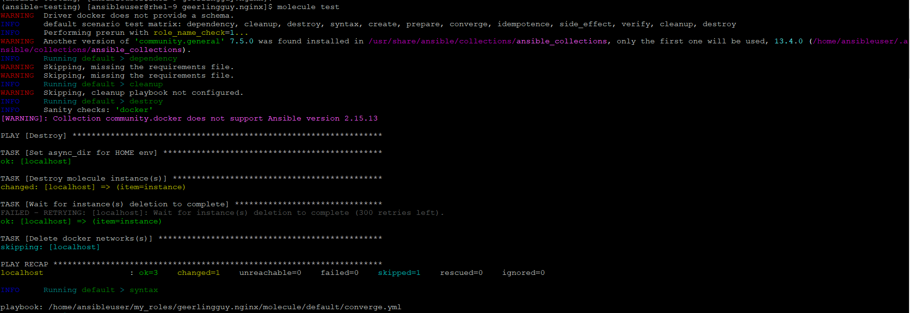
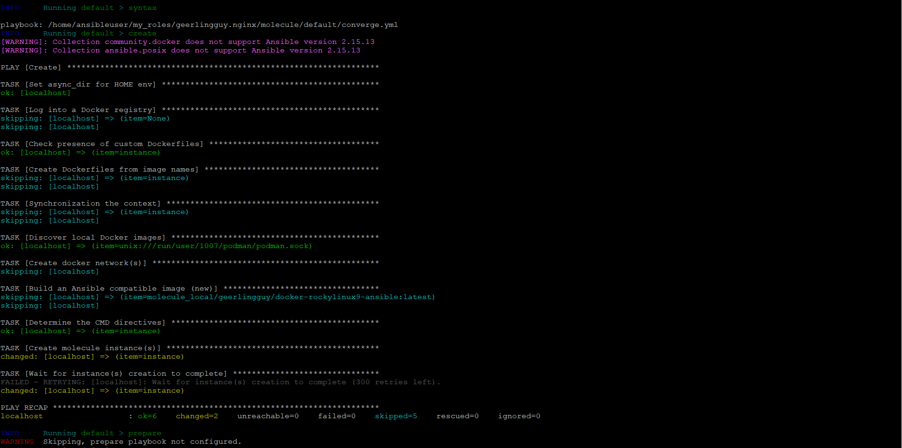
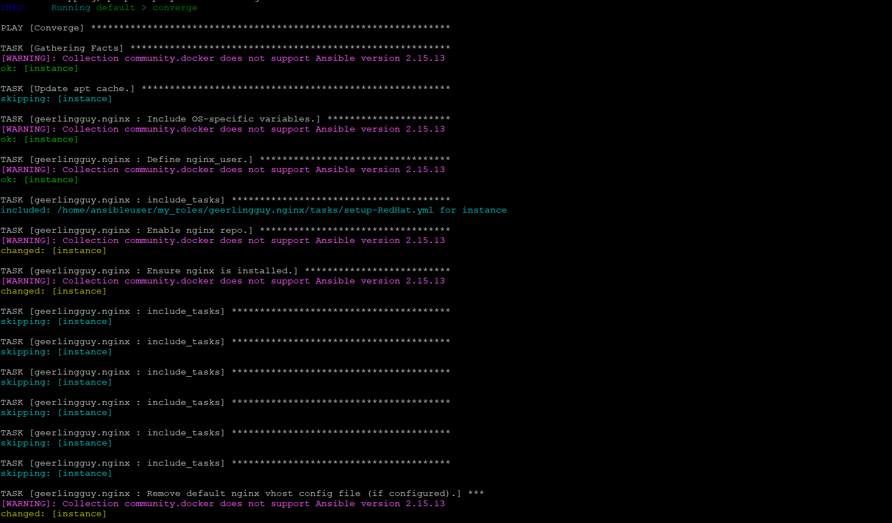
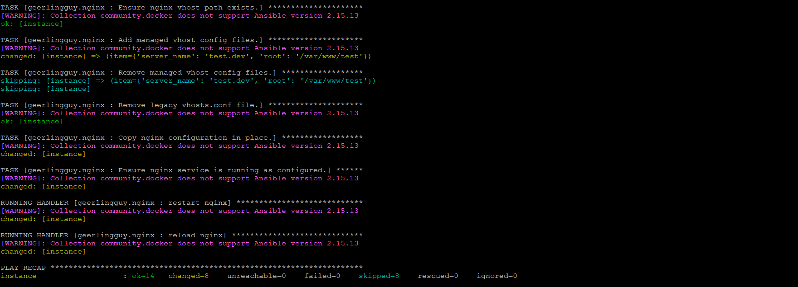
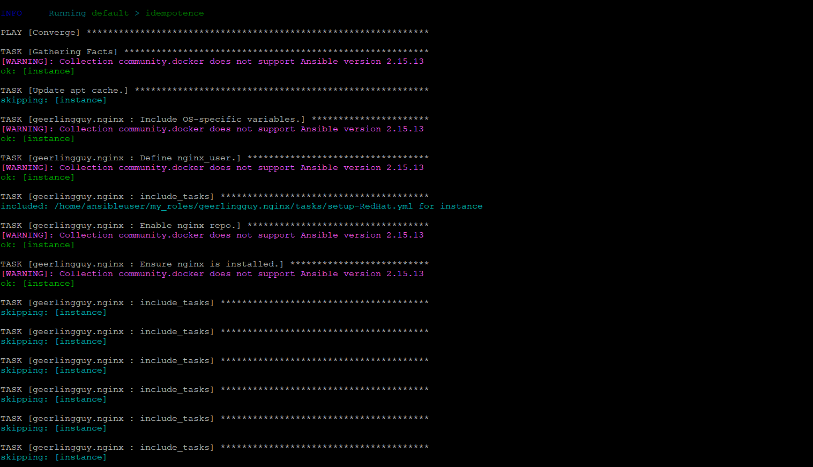
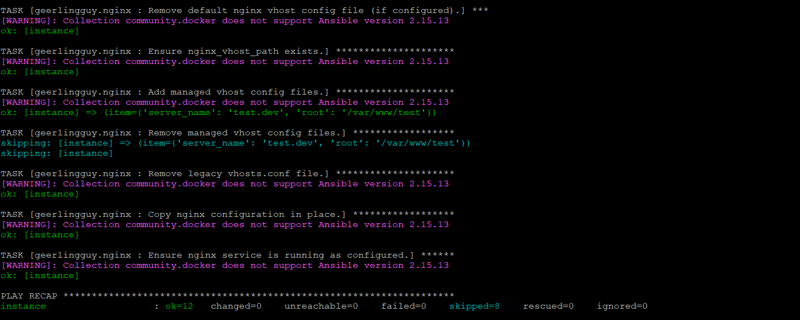
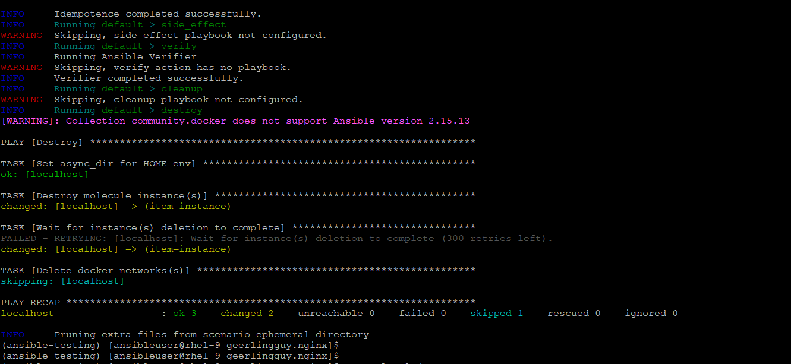
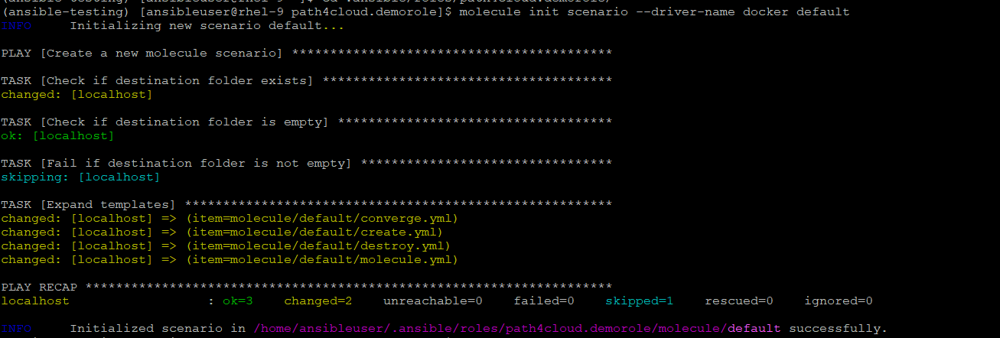
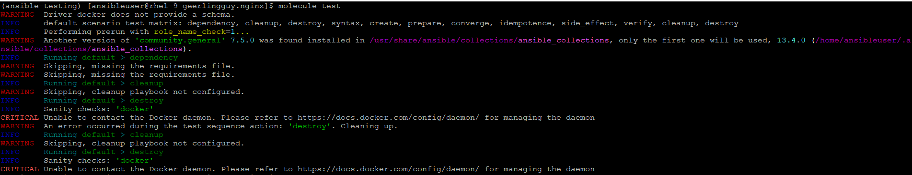
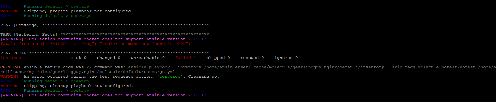

# What is Molecule
Molecule is the official testing framework for Ansible. Instead of manually running your role against real servers to see if it works, Molecule automatically spins up ephemeral test environments (like local Docker containers, Podman, or cloud VMs), executes your role tasks, verifies the setup, and destroys the test environment when finished.

- 📂 File Breakdown & Purpose
    - molecule/
        - The root configuration directory for all automated tests.
    - molecule/default/
        - The default testing scenario. You can have multiple scenarios (e.g., default, ubuntu_test, centos_test) to validate different environments.
    - molecule/default/molecule.yml
        - The Blueprint: This is the core configuration file for the test. It defines the driver (e.g., docker, podman), the target platforms (e.g., rockylinux:9, ubuntu:22.04), and how to verify if the configurations were successful.
    - molecule/default/converge.yml
        - The Test Playbook: This is a simple standard playbook that Molecule executes to apply your custom role onto the test containers. It mimics exactly how a real user would call your role in production.

###  How to Run this Test
- If you have Molecule installed on your system, you navigate to the root of this role folder and execute:

        $ molecule test

    - What happens behind the scenes when you run it:
        - dependency: Downloads any required collections/roles.
        - create: Spins up the container specified in molecule.yml.
        - converge: Runs converge.yml to apply your role onto the container.
        - idempotence: Runs the role a second time to guarantee it reports changed=0 (ensuring idempotency) [Enforce Strict Idempotency].
        - destroy: Tears down the containers, leaving your host system clean.

- If not installed, then follow below to Install Molecule on RHEL 9
```
Install System Development Prerequisites
$ sudo dnf install -y python3-pip python3-devel gcc git

Create and Activate a Testing Virtual Environment
$ python3 -m venv ~/.venvs/ansible-testing

Activate it
$ source ~/.venvs/ansible-testing/bin/activate
(Your prompt will change to show (ansible-testing) at the beginning, meaning the isolated environment is active).
(ansible-testing) [ansibleuser@rhel-9 ~]$
```
```
(ansible-testing) [ansibleuser@rhel-9 ~] $ pip install --upgrade pip
Requirement already satisfied: pip in ./.venvs/ansible-testing/lib/python3.9/site-packages (21.3.1)
Collecting pip
  Downloading pip-26.0.1-py3-none-any.whl (1.8 MB)
     |████████████████████████████████| 1.8 MB 216 kB/s
Installing collected packages: pip
  Attempting uninstall: pip
    Found existing installation: pip 21.3.1
    Uninstalling pip-21.3.1:
      Successfully uninstalled pip-21.3.1
Successfully installed pip-26.0.1
```
```
Install Molecule with Drivers via pip
(Once inside the active environment, install Molecule along with the Podman plugin (RHEL 9's default container engine engine) and coding standards linters)
$ pip install ansible-core molecule "molecule-plugins[podman]" ansible-lint yamllint

But our project relies on docker container so we install with docker.
[ansibleuser@rhel-9 geerlingguy.nginx] $ cat molecule/default/molecule.yml
---
role_name_check: 1
dependency:
  name: galaxy
  options:
    ignore-errors: true
driver:
  name: docker
.
.
.
```
```
(ansible-testing) [ansibleuser@rhel-9 ~]$ pip install ansible-core molecule "molecule-plugins[docker]" ansible-lint yamllint
.
.
.
.
Installing collected packages: resolvelib, urllib3, typing-extensions, tomli, subprocess-tee, ruamel.yaml, rpds-py, PyYAML, pytokens, pygments, pycparser, pluggy, platformdirs, pathspec, packaging, mypy-extensions, mdurl, MarkupSafe, importlib-resources, idna, filelock, distro, click, charset_normalizer, certifi, bracex, attrs, yamllint, wcmatch, selinux, requests, referencing, markdown-it-py, jinja2, click-help-colors, cffi, black, rich, jsonschema-specifications, docker, cryptography, jsonschema, enrich, ansible-core, ansible-compat, molecule, ansible-lint, molecule-plugins
Successfully installed MarkupSafe-3.0.3 PyYAML-6.0.3 ansible-compat-24.10.0 ansible-core-2.15.13 ansible-lint-6.22.2 attrs-26.1.0 black-25.11.0 bracex-2.6 certifi-2026.7.22 cffi-2.0.0 charset_normalizer-3.5.1 click-8.1.8 click-help-colors-0.9.4 cryptography-50.0.1 distro-1.9.0 docker-7.2.0 enrich-1.2.7 filelock-3.19.1 idna-3.20 importlib-resources-5.0.7 jinja2-3.1.6 jsonschema-4.25.1 jsonschema-specifications-2025.9.1 markdown-it-py-3.0.0 mdurl-0.1.2 molecule-6.0.3 molecule-plugins-23.6.0 mypy-extensions-1.1.0 packaging-26.3 pathspec-1.1.1 platformdirs-4.4.0 pluggy-1.6.0 pycparser-2.23 pygments-2.21.0 pytokens-0.4.1 referencing-0.36.2 requests-2.32.5 resolvelib-1.0.1 rich-15.0.0 rpds-py-0.27.1 ruamel.yaml-0.19.1 selinux-0.3.0 subprocess-tee-0.4.2 tomli-2.4.1 typing-extensions-4.16.0 urllib3-2.6.3 wcmatch-10.1 yamllint-1.37.1
```
```yaml
(ansible-testing) [ansibleuser@rhel-9 ~]$ molecule --version
molecule 6.0.3 using python 3.9
    ansible:2.15.13
    azure:23.6.0 from molecule_plugins
    containers:23.6.0 from molecule_plugins requiring collections: ansible.posix>=1.3.0 community.docker>=1.9.1 containers.podman>=1.8.1
    default:6.0.3 from molecule
    docker:23.6.0 from molecule_plugins requiring collections: community.docker>=3.4.11 ansible.posix>=1.4.0
    ec2:23.6.0 from molecule_plugins
    gce:23.6.0 from molecule_plugins requiring collections: google.cloud>=1.0.2 community.crypto>=1.8.0
    openstack:23.6.0 from molecule_plugins requiring collections: openstack.cloud>=2.1.0
    podman:23.6.0 from molecule_plugins requiring collections: containers.podman>=1.7.0 ansible.posix>=1.3.0
    vagrant:23.6.0 from molecule_plugins
```
```
Now that the tool is available, you can navigate straight into your geerlingguy.nginx folder and execute molecule test to run automated functional verifications!

$ molecule test
```
- When you execute molecule test, it runs through a strict matrix of automated checks. It mathematically proves three critical qualities about your Ansible automation code:
    1. It Proves Clean Installation ("The Day-1 Test")
    2. It Proves Strict Idempotency ("The Day-2 Test")
    3. It Proves Multi-OS Compatibility

- Here, are the result.
- Phase 1: Pre-Run Infrastructure Preparation

    

    

    1. INFO Running default > dependency
        - What it did: Molecule looks for an external file like requirements.yml to see if this role needs to download other community dependencies from Ansible Galaxy before starting.
        - Result: Skipping, missing the requirements file. (Clean skip since this standalone Nginx role doesn't depend on other roles).
    2. INFO Running default > destroy
        - What it did: Before starting a fresh test, Molecule runs a safety sweep to destroy and delete any leftover zombie containers named instance from previous failed runs to guarantee a 100% clean testing workspace.
        - Result: changed: [localhost] => (item=instance) (It successfully wiped out old test remnants).
    3. INFO Running default > syntax
        - What it did: It checks your code formatting using the raw playbooks engine to catch syntax errors, missing indents, or invalid characters before spinning up infrastructure.
        - Result: Passed without a single spelling or YAML block layout error.
    4. INFO Running default > create
        - What it did: Molecule speaks directly to your mapped podman.sock daemon interface and instructs it to build the isolated container system specified in your molecule.yml blueprint (geerlingguy/docker-rockylinux9-ansible:latest).
        - Result: changed: [localhost]. Your system successfully pulled down the image, launched it rootless, and mounted the necessary /sys/fs/cgroup parameters so systemd services can run.

- Phase 2: Code Execution & Day-1 Test

    

    

    5. INFO Running default > converge
        - What it did: This is the core execution window. Molecule runs the main test playbook (converge.yml) to apply your custom role onto the fresh target container (hosts: all).
    - Inside the Converge steps, notice the automated platform routing logic:
        - TASK [Update apt cache.] -> skipping: Skipped automatically because it detected your container is a Red Hat/Rocky container, not a Debian/Ubuntu one!
        - TASK [geerlingguy.nginx : include_tasks] -> setup-RedHat.yml: The role dynamically checked the target system's facts, recognized the host family, and pulled in the appropriate package manager configuration file for Red Hat enterprise setups.
        - changed: [instance]: The role executed changes inside the sandbox, enabling official Nginx package repositories, downloading the nginx server application via DNF, removing standard factory configurations, applying your custom vhost file (test.dev), and starting up the system service cleanly.
        - RUNNING HANDLER [restart/reload nginx]: The role triggered handlers at the very end to seamlessly cycle the service and apply the web configuration.
        - Converge Recap Status: ok=14 changed=8. This proves your role can successfully deploy the application from scratch on a blank OS.

- Phase 3: The Idempotency & Clean-Up Validation

    

    

    6. INFO Running default > idempotence
        - What it did: Molecule runs the exact same converge.yml playbook a second time back-to-back against the same container.
        - The Logic Check: If your automation code is written correctly, the second pass must do absolutely nothing because the correct state was already achieved during step 5.
        - Result: ok=12 changed=0. Because changed was exactly zero, Molecule reports: Idempotence completed successfully.. This officially proves your role is safe to run repeatedly on production servers without breaking states or causing service disruption.

    

    7. INFO Running default > verify
        - What it did: Molecule looks for external verification scripts (like Testinfra or an automation verification playbook) to run assertions validating that port 80 is listening or web payloads return HTTP 200.
        - Result: Skipping, verify action has no playbook. (Clean skip as none were explicitly declared in your test folder).

    8. INFO Running default > destroy
        - What it did: The final automated tear-down phase. Since the entire test matrix passed with flying colors, Molecule stops the active testing container and deletes it completely from your local Podman space to free up machine RAM and CPU assets.
        - Result: changed: [localhost]. The container was terminated cleanly, leaving your workstation exactly how it found it.

## The Test Purpose
- In production environments, developers never run molecule test manually on their laptops. Instead, you push your role to GitHub [To host your custom Ansible role on GitHub]. A GitHub Action or Jenkins pipeline automatically detects the push, runs molecule test inside a headless server, and blocks your code from being merged into production if even a single task or idempotency check fails.
- In an enterprise production environment, automated testing via a CI/CD pipeline acts as the absolute quality gate for your infrastructure code. Instead of relying on a developer manually running molecule test on their laptop, a centralized automation server handles it cleanly, consistently, and transparently for the entire team.
- Here is the complete end-to-end lifecycle of how an Ansible role moves from a developer's machine, through a GitHub Actions CI/CD pipeline using Molecule, and safely into production. The Architecture Overview:
    ```
    [ Dev Laptop ] ---> Git Push ---> [ GitHub Pull Request ]
                                                │
                                        (Triggers CI Pipeline)
                                                ▼
                                    [ GitHub Actions Runner ]
                                        ├── Install Python & Molecule
                                        ├── Start Docker/Podman Service
                                        └── Run: molecule test 
                                                │
                        ┌──────────────────────┴──────────────────────┐
                        ▼                                             ▼
                    [ TEST FAILS ❌ ]                             [ TEST PASSES ✅ ]
                • Logs error to GitHub                        • Green checkmark given
                • Blocks Merge to Main                        • Merge Allowed to Main
                • Production remains safe!                    • Automatically Published 
    ```

## How to Create Molecule Tests for Your Custom Role
- Initialize Molecule inside your custom role. Navigate to your role folder and tell Molecule to generate the test files for you automatically:
    ```
    $ cd /home/ansibleuser/my_roles/path4cloud.demorole
    $ molecule init scenario --driver-name docker default
    (This instantly creates the molecule/default/ folder structure inside your role, containing brand-new molecule.yml and converge.yml files [Standard Directory Structure of a Role].)

    $ (ansible-testing) [ansibleuser@rhel-9 path4cloud.demorole]$ tree -F molecule/
    molecule/
    └── default/
        ├── converge.yml
        ├── create.yml
        ├── destroy.yml
        └── molecule.yml

    1 directory, 4 files
    ```

    

- Open the generated files and customize them to fit your role's specific needs.

## Common Error and their Fix
- When Molecule cannot talk to the Docker engine daemon service on your local machine

    

    - Fix
    ```
    Based on the configuration file, you must use Docker [cat molecule/default/molecule.yml]. However, on Red Hat Enterprise Linux 9 (RHEL 9), Podman is the default factory-installed container manager, and the native Docker service engine is either completely missing or currently stopped.

    How to Fix: Bridge Podman to Act Like Docker
    $ systemctl --user enable --now podman.socket

    $ systemctl --user status podman.socket

    Export the Docker Environment Path
    $ export DOCKER_HOST="unix:///run/user/$(id -u)/podman/podman.sock"   
    (Make it Permanent (Highly Recommended))
    $ echo 'export DOCKER_HOST="unix:///run/user/$(id -u)/podman/podman.sock"' >> ~/.bashrc
    ```

-  The Fatal Error in the converge Phase

        fatal: [instance]: FAILED! => {"msg": "docker command not found in PATH"}

    

    - Fix
    ```
    To fix this error, you need to tell your RHEL 9 operating system that whenever Molecule asks for the docker command line application, it should seamlessly route that request to podman instead.

    $ mkdir -p ~/.local/bin
    $ ln -s /usr/bin/podman ~/.local/bin/docker

    $ source ~/.bashrc

    $ which docker
    ```