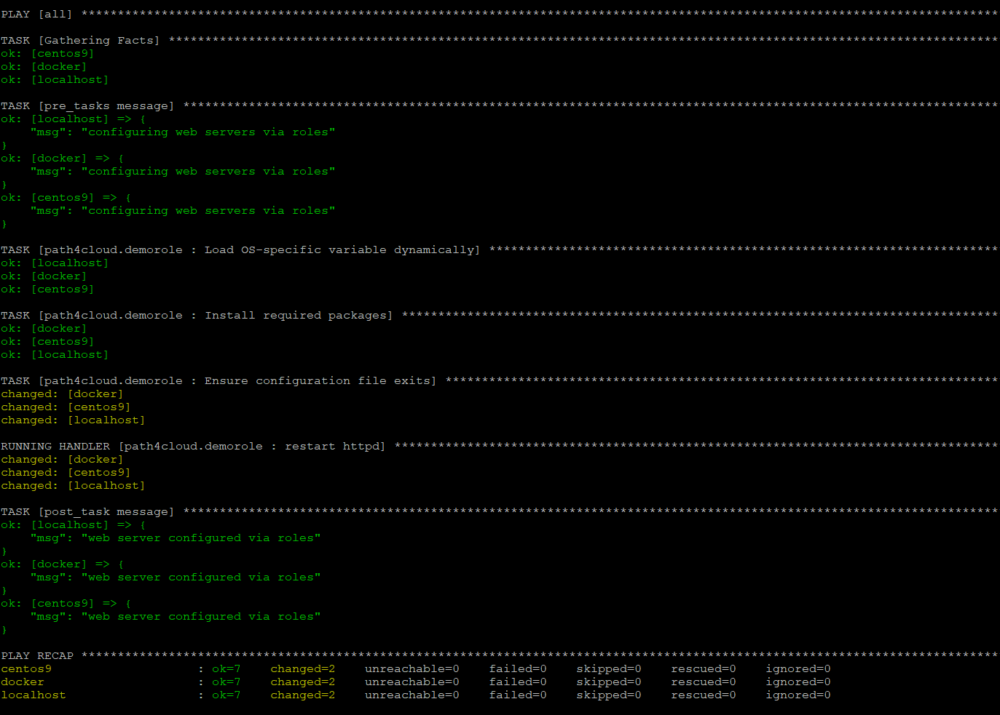
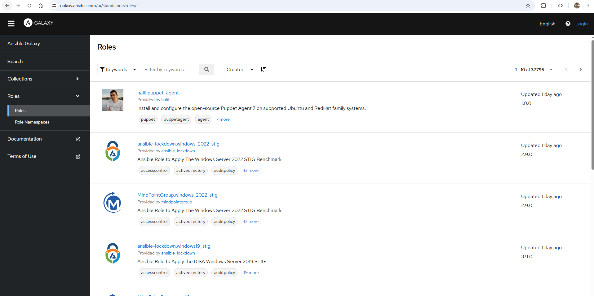

## Creating Roles
- To create a new Ansible role with the standard directory structure, use the built-in ansible-galaxy CLI tool.

- We can verify the roles default path and if required we can modify it.
```
$ ansible-config dump | grep -i roles
DEFAULT_ROLES_PATH(default) = ['/home/ansibleuser/.ansible/roles', '/usr/share/ansible/roles', '/etc/ansible/roles']
```

- The `ansible-galaxy role init` command does not read your `DEFAULT_ROLES_PATH` to decide where to create a new role. By default, it always creates the role folder right inside your current working directory (wherever your terminal prompt is currently sitting).
- The `DEFAULT_ROLES_PATH` configuration from dumped is a search path used exclusively when running playbooks or installing external roles from the internet, not for initializing new blank roles locally.

```
$ pwd
/home/ansibleuser

$ ansible-galaxy role init path4cloud.demorole
- Role path4cloud.demorole was created successfully

$ ls -ld path4cloud.demorole
drwxr-xr-x. 10 ansibleuser ansibleuser 135 Sep 26 04:28 path4cloud.demorole

$ tree path4cloud.demorole/
path4cloud.demorole/
├── defaults
│   └── main.yml
├── files
├── handlers
│   └── main.yml
├── meta
│   └── main.yml
├── README.md
├── tasks
│   └── main.yml
├── templates
├── tests
│   ├── inventory
│   └── test.yml
└── vars
    └── main.yml

8 directories, 8 files
```
- How to force ansible-galaxy to create it in your roles path:
    - If you want the role to be generated automatically inside one of your configured global search paths (like /home/ansibleuser/.ansible/roles), you must explicitly pass the path using the `--init-path` flag.
```
$ ansible-galaxy role init path4cloud.demorole --init-path=/home/ansibleuser/.ansible/roles
- Role path4cloud.demorole was created successfully

$ ansible-galaxy list
# /home/ansibleuser/.ansible/roles
- path4cloud.demorole, (unknown version)
```
### How to make Ansible find your custom role if `--init-path` is not used
You have two primary ways to make sure Ansible recognizes and runs your new role in playbooks:
- Method 1: Keep it next to your Playbook (Best Practice)
    - In production, you usually want your roles inside your specific project directory. Simply structure your project like this:
    ```
    my-project/
    ├── 68-rhel_role_timesync.yaml   # Your playbook
    └── roles/
        └── path4cloud.demorole/     # Move your created role folder here
    ```
    - When you run a playbook, Ansible automatically checks the local roles/ directory relative to the playbook file first.

- Method 2: Configure the global path in ansible.cfg
    - If you want to keep all your custom roles in a specific centralized directory (e.g., /home/ansibleuser/roles), tell Ansible where to look by updating your ansible.cfg file:
    ```ini
    [defaults]
    roles_path = /home/ansibleuser/roles:/usr/share/ansible/roles
    ```
    - Once you add your custom path to roles_path and run `ansible-galaxy list`, your `path4cloud.demorole` will show up cleanly at the bottom of the list.

## Standard guidelines for role content development
Developing clean, modular, and maintainable Ansible roles requires adherence to industry best practices. Structuring content cleanly ensures roles remain **idempotent, reusable**, and easy for team members to debug.
1. Enforce Strict Idempotency
    - A role must be able to run multiple times against the same host without changing configurations or restarting services unless an actual change occurred.
        - Avoid ansible.builtin.shell or command unless necessary: Standard modules (like ansible.builtin.package, file, or template) are natively idempotent. If you must use a shell command, always use creates or removes arguments to skip execution if the state already exists.
        - Control Service Restarts via Handlers: Never use a direct task to restart a service. Always use notify to point to a handler so the service restarts only if a configuration file changes [Ansible Playbook Sequence Example].

2. Leverage Variable Precedence Correctly
    - Ansible provides separate folders for variables (defaults/ vs vars/). Utilize them to make your roles flexible:
        - defaults/main.yml (Low Priority): Put every variable that a user might want to change here. Use clear, human-readable defaults (e.g., apache_port: 80).
        - vars/main.yml (High Priority): Hardcode internal constants that should never be altered by the user running the playbook (e.g., OS-specific package names or internal application paths).
        - Namespace your variables: Always prefix your variables with the role name to prevent namespace collisions (e.g., use demorole_install_path instead of just install_path).

3. Keep Tasks Small, Monolithic, and Readable
    - Avoid writing massive, long files inside tasks/main.yml.
        - Break up workflows: Use ansible.builtin.import_tasks or include_tasks to split large roles into logical sub-files (e.g., install.yml, configure.yml, secrets.yml) [Static importing (import_*) in Ansible, Real-Time Scenario: Reusing Large, Linear Configuration Blocks].
        - Always name your tasks: Provide descriptive, action-oriented strings for the name: attribute of every single task to make playbook tracking clear.

4. Separate Code from Data (Templates vs Files)
    - Use the files/ directory strictly for static, unchanging objects (e.g., a static corporate background image or a fixed repo file).
    - Use the templates/ directory with Jinja2 (.j2) extensions for files that change dynamically based on target host specs or variables (e.g., configuration files pulling distinct memory or IP settings) [Standard Directory Structure of a Role].

5. Standardise Error Handling with Blocks
    - Wrap risky blocks of tasks (like API interactions or database updates) inside a block structure to catch failures gracefully.
    ```yaml
    - name: Database Configuration Block
      block:
        - name: Import initial database schema
          ansible.builtin.mysql_db:
            name: prod_db
            state: import
      rescue:
        - name: Alert team on failure
          ansible.builtin.debug:
            msg: "Database migration failed! Rolling back changes..."
    ```

6. Document with meta/main.yml and README.md
    - If you share your role or look at it six months from now, documentation is vital.
        - Complete the fields in meta/main.yml to specify supported platforms (e.g., RHEL 9, Ubuntu 22) and upstream role dependencies.
        - Maintain a standard README.md file listing all required input variables, expected parameters, and a basic sample playbook layout [Standard Directory Structure of a Role].

## DEMO
```
$ pwd
/home/ansibleuser/.ansible/roles/path4cloud.demorole

$ tree -F .
.
├── defaults/
│   └── main.yml
├── files/
├── handlers/
│   └── main.yml
├── meta/
│   └── main.yml
├── README.md
├── tasks/
│   └── main.yml
├── templates/
│   └── index.j2
├── tests/
│   ├── inventory
│   └── test.yml
└── vars/
    ├── Debian.yml
    ├── main.yml
    └── RedHat.yml

8 directories, 11 files
```
- Refer this [directory](../LAB/path4cloud.demorole/) and copy the below files to your custom role:
    - [RedHat.yml](../LAB/path4cloud.demorole/vars/RedHat.yml) to `vars/RedHat.yml`
    - [Debian.yml](../LAB/path4cloud.demorole/vars/Debian.yml) to `vars/Debian.yml`
    - [handlers/main.yml](../LAB/path4cloud.demorole/handlers/main.yml) to `handlers/main.yml`
    - [templates/index.j2](../LAB/path4cloud.demorole/templates/index.j2) to `templates/index.j2`
    - [tasks/main.yml](../LAB/path4cloud.demorole/tasks/main.yml) to `tasks/main.yml`
- Run this playbook [69-my_custom_roles](../LAB/69-my_custom_roles.yaml), which will refer to this custom roles.

```
$ ansible-playbook 69-my_custom_roles.yaml
```



- verify
```yaml
$ ansible docker -m uri -a "url=http://localhost return_content=true"
docker | SUCCESS => {
    "accept_ranges": "bytes",
    "ansible_facts": {
        "discovered_interpreter_python": "/usr/bin/python3"
    },
    "changed": false,
    "connection": "close",
    "content": "Welcome to DOCKER!! running on Ubuntu 24.04 and deployed via custom roles.\n\nMy FQDN is docker.path4cloud.com.\n",
    "content_length": "110",
    "content_type": "text/html",
    "cookies": {},
    "cookies_string": "",
    "date": "Sat, 26 Sep 2026 00:13:50 GMT",
    "elapsed": 0,
    "etag": "\"6e-65c577dfa9359\"",
    "last_modified": "Fri, 25 Sep 2026 23:58:25 GMT",
    "msg": "OK (110 bytes)",
    "redirected": false,
    "server": "Apache/2.4.58 (Ubuntu)",
    "status": 200,
    "url": "http://localhost",
    "vary": "Accept-Encoding"
}
```
---
# Ansible Galaxy
The ansible-galaxy command-line tool is Ansible's official built-in package manager. It is used to initialize, download, install, and manage community-built Roles and Collections.

### Common ansible-galaxy Commands
- Create a new role structure locally:
    
        $ ansible-galaxy role init my_custom_role
- Install a role from the public Galaxy community repository:

        $ ansible-galaxy role install geerlingguy.nginx
- List all installed roles on your system:

        $ ansible-galaxy role list

### Galaxy Website
- [Here](https://galaxy.ansible.com/ui/) is the ansible galaxy website hosted where all roles and collections are published.



## Command line Options with `ansible-galaxy`
```
$ ansible-galaxy role --help
usage: ansible-galaxy role [-h] ROLE_ACTION ...

positional arguments:
  ROLE_ACTION
    init       Initialize new role with the base structure of a role.
    remove     Delete roles from roles_path.
    delete     Removes the role from Galaxy. It does not remove or alter the actual GitHub repository.
    list       Show the name and version of each role installed in the roles_path.
    search     Search the Galaxy database by tags, platforms, author and multiple keywords.
    import     Import a role into a galaxy server
    setup      Manage the integration between Galaxy and the given source.
    info       View more details about a specific role.
    install    Install role(s) from file(s), URL(s) or Ansible Galaxy

options:
  -h, --help   show this help message and exit
```

- Further options with ROLE_ACTION
```
$ ansible-galaxy role search --help
usage: ansible-galaxy role search [-h] [-s API_SERVER] [--token API_KEY] [-c] [--timeout TIMEOUT] [-v] [--platforms PLATFORMS] [--galaxy-tags GALAXY_TAGS] [--author AUTHOR]
                                  [searchterm ...]

positional arguments:
  searchterm            Search terms

options:
  -h, --help            show this help message and exit
  -s API_SERVER, --server API_SERVER
                        The Galaxy API server URL
  --token API_KEY, --api-key API_KEY
                        The Ansible Galaxy API key which can be found at https://galaxy.ansible.com/me/preferences.
  -c, --ignore-certs    Ignore SSL certificate validation errors.
  --timeout TIMEOUT     The time to wait for operations against the galaxy server, defaults to 60s.
  -v, --verbose         Causes Ansible to print more debug messages. Adding multiple -v will increase the verbosity, the builtin plugins currently evaluate up to -vvvvvv. A reasonable
                        level to start is -vvv, connection debugging might require -vvvv. This argument may be specified multiple times.
  --platforms PLATFORMS
                        list of OS platforms to filter by
  --galaxy-tags GALAXY_TAGS
                        list of galaxy tags to filter by
  --author AUTHOR       GitHub username
```
```
$ ansible-galaxy role search nginx --platforms EL --galaxy-tags system --author geerlingguy

Found 1 roles matching your search:

 Name              Description
 ----              -----------
 geerlingguy.nginx Nginx installation for Linux, FreeBSD and OpenBSD.
 ```
 ```
 Flag-by-Flag Breakdown
 
 ** ansible-galaxy role search nginx: Tells the tool to search the internet registry for any role containing the keyword "nginx" in its name or description.
 
 ** --platforms EL: Filters the search results to only show roles compatible with Enterprise Linux (EL) platforms. This includes RHEL (Red Hat Enterprise Linux), CentOS, Rocky Linux, and AlmaLinux.
 
 ** --galaxy-tags system: Further narrows down the search results by requiring the role to be explicitly tagged with the metadata label "system" by its author.

 ** --author geerlingguy: You want the role written by Jeff Geerling (a very popular Ansible contributor).
 ```
 - Installing at a specific directory, we can specify the path with `-p` flag while installing it.
 ```
 $ ansible-galaxy role install geerlingguy.nginx -p /home/ansibleuser/my_roles
Starting galaxy role install process
- downloading role 'nginx', owned by geerlingguy
- downloading role from https://github.com/geerlingguy/ansible-role-nginx/archive/3.3.1.tar.gz
- extracting geerlingguy.nginx to /home/ansibleuser/my_roles/geerlingguy.nginx
- geerlingguy.nginx (3.3.1) was installed successfully
```
- If we are intalling it at custom path and want list command will look at that path, then we need to udpate the `roles_path` in `ansible.cfg` file.
```
roles_path = /home/ansibleuser/my_roles

$ ansible-config dump | grep -i roles
DEFAULT_ROLES_PATH(/home/ansibleuser/.ansible.cfg) = ['/home/ansibleuser/my_roles']

$ ansible-galaxy list
# /home/ansibleuser/my_roles
- geerlingguy.nginx, 3.3.1
```
- verify the file structure of this role
```
$ cd my_roles/
$ ls
geerlingguy.nginx

$ cd geerlingguy.nginx/
$ tree -F
.
├── defaults/
│   └── main.yml
├── handlers/
│   └── main.yml
├── LICENSE
├── meta/
│   └── main.yml
├── molecule/
│   └── default/
│       ├── converge.yml
│       └── molecule.yml
├── README.md
├── tasks/
│   ├── main.yml
│   ├── setup-Archlinux.yml
│   ├── setup-Debian.yml
│   ├── setup-FreeBSD.yml
│   ├── setup-OpenBSD.yml
│   ├── setup-RedHat.yml
│   ├── setup-Suse.yml
│   ├── setup-Ubuntu.yml
│   └── vhosts.yml
├── templates/
│   ├── nginx.conf.j2
│   ├── nginx.repo.j2
│   └── vhost.j2
└── vars/
    ├── AlmaLinux.yml
    ├── Archlinux.yml
    ├── Debian.yml
    ├── FreeBSD.yml
    ├── OpenBSD.yml
    ├── RedHat.yml
    ├── Rocky.yml
    └── Suse.yml

8 directories, 27 files
```
- Check more info about Molecule [here](33-What_is_Molecule.md)