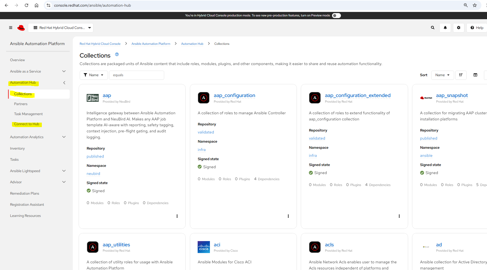
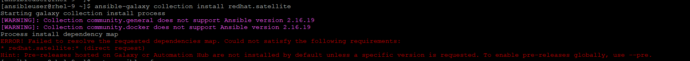
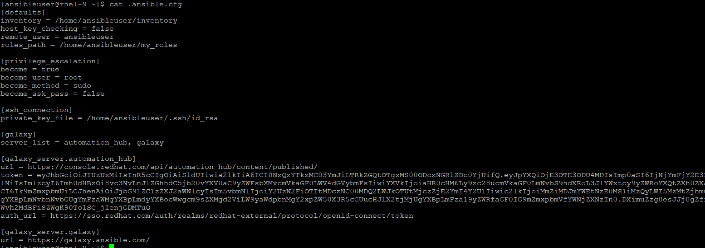
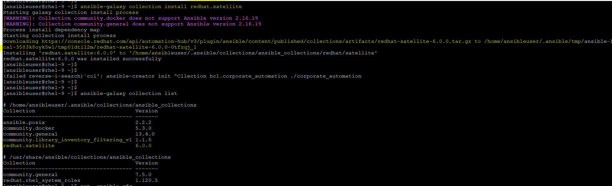

## Ansible Collection
Ansible Collections are the modern standard for distributing Ansible content. Introduced in Ansible 2.9, collections allow the community and vendors to package together playbooks, roles, modules, plugins, and docs into a single, structured distribution unit.


### Structure of a Collection
A typical collection is published under a namespace (e.g., community) and a name (e.g., docker). It follows this layout:
```
namespace/
└── collection_name/
    ├── galaxy.yml          # Metadata (version, author, dependencies)
    ├── docs/               # Documentation files
    ├── plugins/            # Core execution files
    │   ├── modules/        # Custom modules (e.g., python scripts)
    │   └── lookup/         # Lookup plugins
    ├── roles/              # Embedded roles managed by the collection
    └── playbooks/          # Ready-to-run playbooks
```

### Source
In the Ansible ecosystem, Ansible Galaxy and Ansible Automation Hub serve as the two primary repositories for publishing, finding, and downloading Ansible Collections.

- The Core Differences

| Feature | Ansible Galaxy  | Ansible Automation Hub |
|---|---|---|
| **Primary Audience** | Open-source community and individual developers. | Enterprise organizations and mission-critical production environments. |
| **Content Support** | Community-maintained (Upstream, open-source) | Officially supported by Red Hat and certified partner vendors (Downstream) |
| **Cost / Access** | Completely free and public | Requires a paid Red Hat Ansible Automation Platform (AAP) subscription |
---

1. **Ansible Galaxy (The Community Repository)**

    Ansible Galaxy is the upstream, public hub for the global open-source community.
    - How it works: Anyone with a GitHub account can bundle an Ansible Collection and publish it to Galaxy.
    - The Pros: It contains an immense volume of collections covering almost every niche tool, cloud provider, and operating system configuration imaginable.
    - The Cons: Because it is unverified modules or roles can break if a maintainer abandons the repository, and code quality varies wildly.
    - CLI Reference: By default, the ansible-galaxy CLI tool is pre-configured to look directly at Galaxy when you run an installation command.

2. **Ansible Automation Hub (The Enterprise Repository)**

    Ansible Automation Hub is Red Hat’s enterprise-grade, downstream repository hosted on the Red Hat Hybrid Cloud Console.
    - Certified Content: Content here is officially developed or certified by Red Hat and major industry partners (such as Cisco, AWS, Arista, F5, NetApp, and Microsoft).
    - The Enterprise Promise: If a certified collection breaks your infrastructure, Red Hat and the respective vendor provide enterprise SLA technical support to fix it.
    - Private Automation Hub: For completely air-gapped or tightly regulated security environments, Red Hat allows companies to download a local instance called `Private Automation Hub`. Organizations use this private mirror to vet, approve, and sign internal collections before letting developers download them.

### How to Configure Your Projects to Use Both
You configure this priority hierarchy inside your project's ansible.cfg file:

```yaml
[galaxy]
# 1. Establish the search sequence order (Left to Right)
server_list = automation_hub, validated_hub, galaxy

[galaxy_server.automation_hub]
# 2. Red Hat Certified Content URL from the image
url = https://console.redhat.com/api/automation-hub/content/published/
# Generate your token by clicking the "Load token" button in the UI
token = YOUR_RED_HAT_OFFLINE_TOKEN
auth_url = https://sso.redhat.com/auth/realms/redhat-external/protocol/openid-connect/token

[galaxy_server.validated_hub]
# 3. Red Hat Validated Content URL from the image
url = https://console.redhat.com/api/automation-hub/content/validated/
token = YOUR_RED_HAT_OFFLINE_TOKEN
auth_url = https://sso.redhat.com/auth/realms/redhat-external/protocol/openid-connect/token

[galaxy_server.galaxy]
# 4. Standard Open-Source Public Community Hub
url = https://galaxy.ansible.com/
```
When you execute ansible-galaxy collection install -r requirements.yml:
1. Ansible checks automation_hub first. If the collection exists there (e.g., amazon.aws), it downloads the certified, supported enterprise version. And If the collection cannot be found then it will look to validate_hub.
2. If the collection cannot be found in either of these, then Ansible drops down to galaxy to look for the community-maintained version.



** We need tp load the token and map this to server url to download the collection from automation hub

Without Token:



With Token:





## Command line Options with ansible-galaxy
```
$ ansible-galaxy collection -h
usage: ansible-galaxy collection [-h] COLLECTION_ACTION ...

positional arguments:
  COLLECTION_ACTION
    download         Download collections and their dependencies as a tarball for an offline install.
    init             Initialize new collection with the base structure of a collection.
    build            Build an Ansible collection artifact that can be published to Ansible Galaxy.
    publish          Publish a collection artifact to Ansible Galaxy.
    install          Install collection(s) from file(s), URL(s) or Ansible Galaxy
    list             Show the name and version of each collection installed in the collections_path.
    verify           Compare checksums with the collection(s) found on the server and the installed copy. This does not verify dependencies.

options:
  -h, --help         show this help message and exit
```
- Installing at a specific directory, we can specify the path with -p flag while installing it.
    ```
    $ ansible-galaxy collection install amazon.aws -p /home/ansibleuser/my_collection/ --force
    Starting galaxy collection install process
    [WARNING]: The specified collections path '/home/ansibleuser/my_collection' appears to be part of the pip Ansible package. Managing these directly with ansible-galaxy could break the
    Ansible package. Install collections to a configured collections path, which will take precedence over collections found in the PYTHONPATH.
    [WARNING]: Collection community.docker does not support Ansible version 2.16.19
    [WARNING]: Collection amazon.aws does not support Ansible version 2.16.19
    [WARNING]: Collection community.general does not support Ansible version 2.16.19
    Process install dependency map
    Starting collection install process
    Downloading https://console.redhat.com/api/automation-hub/v3/plugin/ansible/content/published/collections/artifacts/amazon-aws-11.5.0.tar.gz to /home/ansibleuser/.ansible/tmp/ansible-local-41589c302jlw/tmp2m4yfb42/amazon-aws-11.5.0-q2s85qh3
    Installing 'amazon.aws:11.5.0' to '/home/ansibleuser/my_collection/ansible_collections/amazon/aws'
    amazon.aws:11.5.0 was installed successfully

    $ ls my_collection/
    ansible_collections
    ```
- **Recommended**: Path which we specify must be referenced with COLLECTION_PATH (else it will break the ansible flow)
    ```
    $ ansible --version
    ansible [core 2.16.19]
    config file = /home/ansibleuser/.ansible.cfg
    configured module search path = ['/home/ansibleuser/.ansible/plugins/modules', '/usr/share/ansible/plugins/modules']
    ansible python module location = /usr/lib/python3.12/site-packages/ansible
    ansible collection location = /home/ansibleuser/.ansible/collections:/usr/share/ansible/collections


    $ ansible-config dump | grep -i collection
    COLLECTIONS_ON_ANSIBLE_VERSION_MISMATCH(default) = warning
    COLLECTIONS_PATHS(default) = ['/home/ansibleuser/.ansible/collections', '/usr/share/ansible/collections']

    ## Set this in ansible.cfg file to set your custom path
    collections_path = /home/ansibleuser/my_collection:~/.ansible/collections:/usr/share/ansible/collections
    ```
- Installing with requirements.yaml file
Like roles, here also it can support the official automation hub, github or local tar ball:
    ```yaml
    ---
    collections:
    # 1. From Ansible Galaxy (Standard Open Source)
    - name: community.docker
        version: "3.4.0"

    # 2. From Ansible Automation Hub (Red Hat Certified Enterprise)
    - name: redhat.satellite
        version: "4.0.0"

    # 3. Directly from a Git Repository
    - name: git+https://github.com
        version: main

    # 4. From a Local Tarball File
    - name: /home/ansibleuser/community-general-8.0.0.tar.gz
        type: file
    ```

    ```yaml
    $ cat requirements.yaml
    ---
    collections:
    - name: amazon.aws
        version: "11.5.0"

    $ ansible-galaxy collection install -r requirements.yaml
    Starting galaxy collection install process
    [WARNING]: Collection community.general does not support Ansible version 2.16.19
    [WARNING]: Collection community.docker does not support Ansible version 2.16.19
    Process install dependency map
    Starting collection install process
    Downloading https://console.redhat.com/api/automation-hub/v3/plugin/ansible/content/published/collections/artifacts/amazon-aws-11.5.0.tar.gz to /home/ansibleuser/.ansible/tmp/ansible-local-41153mlemtzk/tmpzz6c1645/amazon-aws-11.5.0-uie8xzct
    Installing 'amazon.aws:11.5.0' to '/home/ansibleuser/.ansible/collections/ansible_collections/amazon/aws'
    amazon.aws:11.5.0 was installed successfully

    $ ansible-galaxy collection list

    # /home/ansibleuser/.ansible/collections/ansible_collections
    Collection                               Version
    ---------------------------------------- -------
    amazon.aws                               11.5.0
    ```


- Mixing Roles and Collections Together
    ```yaml
    ---
    # Collections Block
    collections:
    - name: amazon.aws
        version: "11.5.0"

    # Roles Block
    roles:
    - src: geerlingguy.nginx
        version: "3.1.2"
    ```